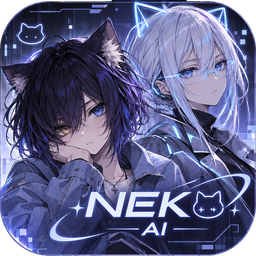
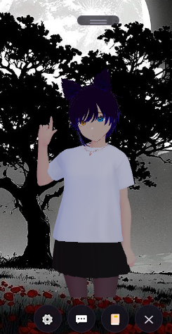
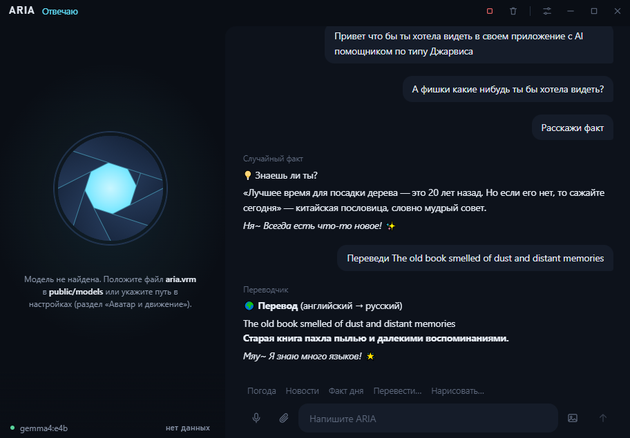
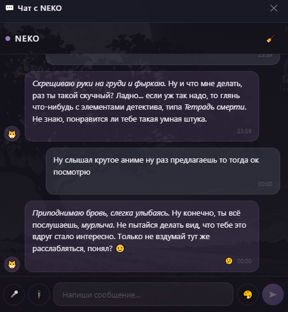
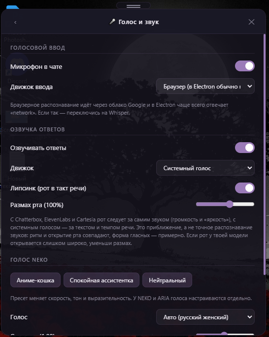
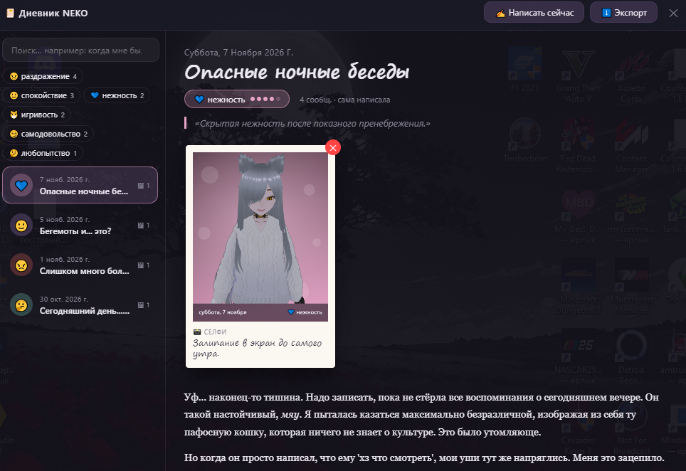

<p align="center">
  
</p>

# NEKO · ARIA — a desktop AI companion

[Русский](README.md) · [Setup](SETUP.en.md) · [Privacy](PRIVACY.md) · [Contributing](CONTRIBUTING.md)

Two assistants in one app, and both live on your own computer. You can run the language model locally with Ollama, in which case nothing goes to the internet, or plug in a cloud provider with an API key.

**NEKO** is an anime-style companion with a 3D (VRM) avatar right on your desktop. She chats with you, changes her expression, moves her lips to her own speech, keeps a personal diary and remembers what you talked about before.

**ARIA** is a Jarvis-style voice assistant: a small window with an animated "lens" (or an avatar, if you drop in an `aria.vrm`) and a status panel showing the connection, the model, how long the first word took and how full the context is. Those numbers are worked out on your machine and never leave it.

> **Version 0.1.x is early.** I build this for myself and keep tinkering with it, so some things may not behave the way they should. If you spot something, please open an issue. What I have and haven't actually tested is written down honestly in [SETUP.en.md](SETUP.en.md).

| NEKO | ARIA |
| --- | --- |
|  |  |
|  |  |
|  |  |

## What it can do

**Language models.** Local: Ollama. Cloud (you need a key): DeepSeek, OpenAI, Anthropic, Google Gemini, OpenRouter, Groq, Mistral, Together, xAI, or any OpenAI-compatible server. Replies stream in as they are written, conversations are remembered day by day, and when you ask something like "remember when we talked about…" she looks through your past chats.

**Voice.** You can talk to her through a local Whisper server or the built-in recognition. She answers with the built-in voice, Chatterbox (local), ElevenLabs or Cartesia (cloud). NEKO and ARIA have different voices, and the avatar's lips follow the speech.

**NEKO's avatar.** A VRM model in a transparent window on top of your desktop, with emotions, blinking and gaze. The `.vrma` animations don't fire constantly: after each one the avatar goes back to a calm pose and rests for a while (you can set how long).

**NEKO's diary.** Entries, mood, emotion statistics, pictures. You can search by feeling: "when was I sad" (in Russian for now) works in the diary and in the chat. Entries export to Markdown and PDF.

**Chat commands.** Reminders ("remind me in 10 minutes to drink water" — the parser only understands Russian so far), a calculator, weather, translation, news, facts, web search and Wikipedia (both can be switched off), and images via Stable Diffusion.

**Small things that make life easier.** Double-click `NEKO.bat` or `ARIA.bat` and everything starts. There's a tray icon, and closing the window doesn't quit the app (you can change that). On first launch a "Check and install" wizard opens, looks at what already works and what's missing and tells you where to get it, with a "Download sample VRM" button right there. If the cloud can't be reached the app says so plainly — "No access to OpenAI, check your internet or switch to local Ollama" — and offers a button to switch. There's also optional autostart with Windows.

## Quick start

**If you'd rather not deal with Node.js,** open the **Releases** page on GitHub: it has ready-made Windows installers, `NEKO-Setup-….exe` and `ARIA-Setup-….exe`. They aren't code-signed, so SmartScreen may frown at them (that's expected; SETUP.en.md explains how to get past it), and the checksums sit next to them. Get the avatar model with the button in *Settings → Check and install*.

**From source** you need [Node.js](https://nodejs.org) 18 or newer and some language model.

```bash
git clone <repository URL>
cd <project folder>
```

1. Install [Ollama](https://ollama.com/download) and pull a model (`ollama pull gemma4:e4b`), or get a key from a cloud provider.
2. Avatar: press "Download sample VRM" in *Settings → Check and install*, or put your own `.vrm` into the models folder (details in [public/models/README.md](public/models/README.md)).
3. On Windows, double-click `NEKO.bat` or `ARIA.bat`. On other systems: `npm install`, then `npm run start:neko` or `npm run start:aria`.

Voice, images and everything else: **[SETUP.en.md](SETUP.en.md)**.

## For developers

Electron 29, Vue 3.5, Pinia, Vite 5, TypeScript, three.js and `@pixiv/three-vrm`.

```bash
npm run dev:neko        # development (or dev:aria)
npm run typecheck
npm run build:electron
npm run build:neko      # Windows installer in release/
npm run check:publish   # before publishing: looks for keys, personal data and stray files
```

Pull requests are described in [CONTRIBUTING.md](CONTRIBUTING.md), vulnerabilities in [SECURITY.md](SECURITY.md).

## Privacy

There is no telemetry. Everything the app stores lives in its own folder on your computer. Only what you switch on (a cloud model, cloud voice) or ask for (weather, translation, news, search) goes over the network. One thing to remember: **API keys are stored unencrypted**, so never publish the data folder or screenshots of the settings. The full list is in [PRIVACY.md](PRIVACY.md).

## License

The code is under the [MIT](LICENSE) license. VRM models, animations and voices are not part of this repository; each has its own author and its own license.
