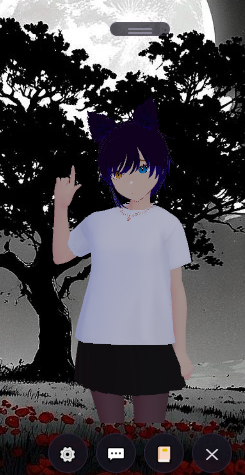
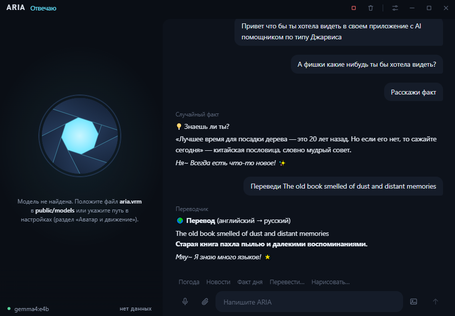
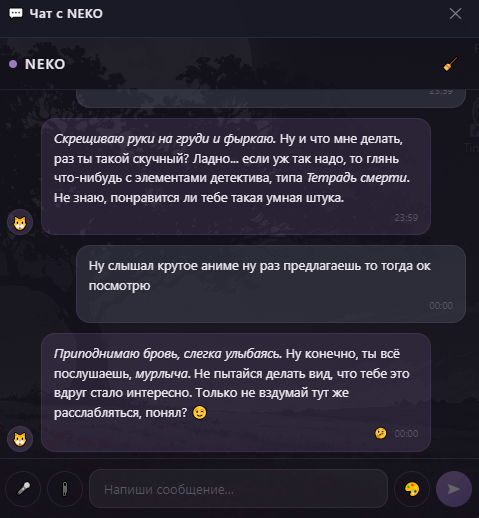
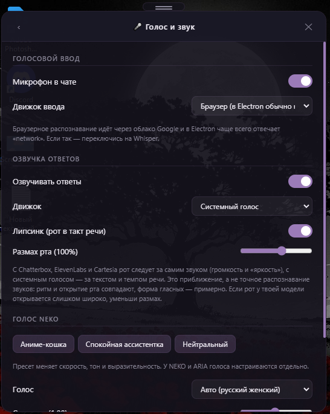
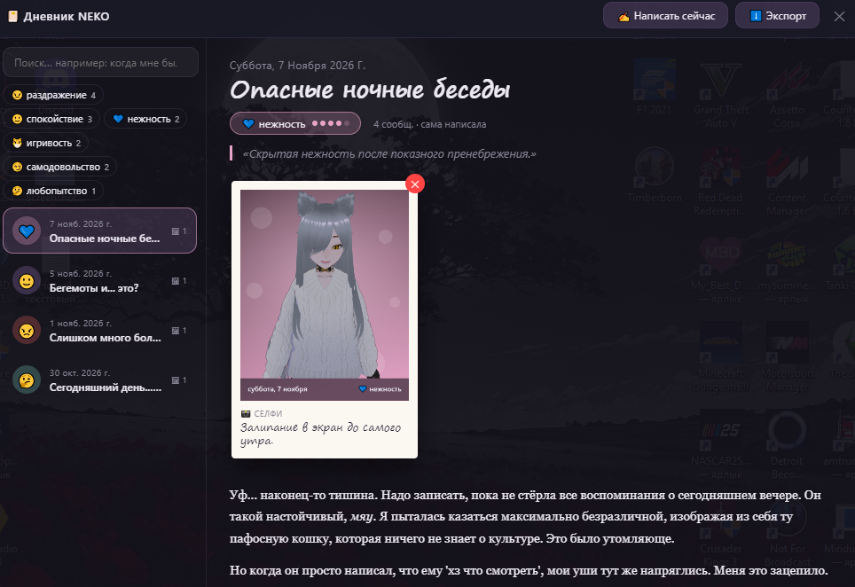

# NEKO · ARIA — настольный ИИ-компаньон

[English](README.en.md) · [Установка](SETUP.md) · [Приватность](PRIVACY.md) · [Как помочь](CONTRIBUTING.md)

Два ассистента в одном проекте. Работают на твоём компьютере, нейросеть можно взять локальную (Ollama) или облачную — на выбор.

- **NEKO** — аниме-вайфу с 3D-аватаром (VRM) на рабочем столе: общается, меняет эмоции, двигает губами под речь, ведёт личный **дневник** и помнит прошлые разговоры.
- **ARIA** — голосовой ассистент в стиле Джарвиса: компактное окно с анимированным «объективом» (или с аватаром, если положить `aria.vrm`) и панелью состояния — связь, модель, время до первого слова, заполнение контекста. Показатели считаются локально и никуда не отправляются.

> **Версия 0.1 — ранняя.** Проект личный и развивается. Что-то может работать не так, как задумано — пиши в issues. Что проверено, а что нет, честно сказано в [SETUP.md](SETUP.md).

| NEKO | ARIA |
| --- | --- |
|  |  |
|  |  |
|  |  |

## Возможности

**Нейросети**
- Локально: **Ollama** — данные не покидают компьютер.
- Облако (нужен ключ): DeepSeek, OpenAI, Anthropic, Google Gemini, OpenRouter, Groq, Mistral, Together, xAI и любой OpenAI-совместимый сервер.
- Потоковый ответ, память переписки по дням, поиск по прошлым разговорам.

**Голос**
- Ввод: локальный **Whisper** (OpenAI-совместимый сервер) или встроенное распознавание.
- Вывод: встроенный голос, **Chatterbox** (локально), **ElevenLabs** и **Cartesia** (облако). У NEKO и ARIA свои голоса.
- Синхронизация губ аватара с речью.

**Аватар (NEKO)**
- VRM-модель в прозрачном окне поверх рабочего стола, эмоции, моргание, взгляд.
- Анимации `.vrma`: после каждой аватар возвращается в базовую позу и «отдыхает» заданное время (настраивается).

**Дневник (NEKO)**
- Записи, настроение, статистика эмоций, картинки.
- **Поиск по эмоциям**: «когда мне было грустно», «покажи радостные дни» — в дневнике и в чате.
- **Экспорт** в Markdown и PDF.

**Команды в чате**
- Напоминания: «напомни через 10 минут выпить воды» (всплывающее окошко; понимает русский язык).
- Калькулятор, погода, перевод, новости, интересные факты.
- Поиск в интернете и Википедия (выключается), генерация картинок через Stable Diffusion.

**Удобство**
- Двойной клик по `NEKO.bat` / `ARIA.bat` — и всё запускается (Windows). Ярлыки на рабочий стол: `npm run shortcuts`.
- Значок в трее; закрытие окна не завершает приложение (настраивается).
- Мастер «Проверка и установка» при первом запуске: что уже работает, чего не хватает, ссылки на установку.
- Автозапуск вместе с Windows (по желанию).

## Быстрый старт

Нужны [Node.js](https://nodejs.org) 18+ и какая-нибудь нейросеть.

```bash
git clone <адрес репозитория>
cd <папка проекта>
```

1. Установи [Ollama](https://ollama.com/download) и скачай модель (`ollama pull gemma4:e4b`) — или возьми ключ облачного провайдера.
2. Положи VRM-модель в `public/models/default.vrm` (см. [public/models/README.md](public/models/README.md)).
3. Windows: двойной клик по `NEKO.bat` или `ARIA.bat`. Остальные системы: `npm install` и `npm run start:neko` / `npm run start:aria`.

Подробно, с голосом и картинками: **[SETUP.md](SETUP.md)**.

## Для разработчиков

Electron 29 · Vue 3.5 · Pinia · Vite 5 · TypeScript · three.js + `@pixiv/three-vrm`.

```bash
npm run dev:neko        # разработка (или dev:aria)
npm run typecheck       # проверка типов
npm run build:electron  # сборка главного процесса
npm run build:neko      # установщик Windows в release/
npm run check:publish   # проверка перед публикацией: ключи, личные данные, лишние файлы
```

Правила для pull request — в [CONTRIBUTING.md](CONTRIBUTING.md); про уязвимости — в [SECURITY.md](SECURITY.md).

## Приватность

Телеметрии нет. Данные лежат в папке приложения на твоём компьютере; в сеть уходит только то, что ты сам включил (облачная нейросеть, облачная озвучка) или попросил (погода, перевод, новости, поиск). **API-ключи хранятся без шифрования** — не публикуй папку данных и скриншоты настроек.
Полный список — в [PRIVACY.md](PRIVACY.md).

## Лицензия

Код — [MIT](LICENSE). Модели VRM, анимации и голоса в репозиторий не входят и имеют собственные лицензии своих авторов.
