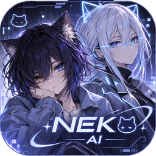

<p align="center">
  
</p>

# NEKO · ARIA — настольный ИИ-компаньон

[English](README.en.md) · [Установка](SETUP.md) · [Приватность](PRIVACY.md) · [Как помочь](CONTRIBUTING.md)

Это два помощника в одной программе, и оба живут у тебя на компьютере. Нейросеть можно взять локальную (Ollama) — тогда ничего не уходит в интернет, — а можно подключить облачную по ключу.

**NEKO** — аниме-девушка с 3D-аватаром (формат VRM) прямо на рабочем столе. Она болтает с тобой, меняет эмоции, двигает губами под свою речь, ведёт личный дневник и помнит, о чём вы говорили раньше.

**ARIA** — голосовой помощник в духе Джарвиса: небольшое окно с анимированным «объективом» (или с аватаром, если положить файл `aria.vrm`) и панелью состояния: связь, модель, сколько ждать первого слова, насколько заполнен контекст. Эти цифры считаются на твоём компьютере и никуда не отправляются.

> **Версия 0.1.x — ранняя.** Я делаю проект для себя и понемногу дорабатываю, так что что-то может вести себя не так, как задумано. Если заметишь — напиши в issues. Что я проверил, а что нет, честно расписано в [SETUP.md](SETUP.md).

| NEKO | ARIA |
| --- | --- |
|  |  |
|  |  |
|  |  |

## Что умеет

**Нейросети.** Локально — Ollama. В облаке — DeepSeek, OpenAI, Anthropic, Google Gemini, OpenRouter, Groq, Mistral, Together, xAI или любой OpenAI-совместимый сервер (нужен ключ). Ответ приходит потоком, переписка запоминается по дням, а при вопросах вроде «помнишь, мы обсуждали…» ассистент ищет по прошлым разговорам.

**Голос.** Говорить с ней можно через локальный Whisper или встроенное распознавание. Отвечает встроенным голосом, Chatterbox (локально), ElevenLabs или Cartesia (облако). У NEKO и ARIA голоса разные. Губы аватара движутся в такт речи.

**Аватар NEKO.** VRM-модель в прозрачном окне поверх рабочего стола: эмоции, моргание, взгляд. Анимации `.vrma` запускаются нечасто — после каждой аватар возвращается в спокойную позу и немного «отдыхает» (сколько именно, настраивается).

**Дневник NEKO.** Записи, настроение, статистика эмоций, картинки. Искать можно по смыслу: «когда мне было грустно», «покажи радостные дни». Работает и в самом дневнике, и в чате. Записи экспортируются в Markdown и PDF.

**Команды в чате.** Напоминания («напомни через 10 минут выпить воды» — пока только по-русски), калькулятор, погода, перевод, новости, факты, поиск в интернете и Википедия (их можно выключить) и картинки через Stable Diffusion.

**Мелочи, которые облегчают жизнь.** Двойной клик по `NEKO.bat` или `ARIA.bat` — и всё запускается. Значок в трее, закрытие окна не выключает программу (это можно изменить). При первом запуске открывается мастер «Проверка и установка»: он сам смотрит, что уже работает, а чего не хватает, и подсказывает, где это взять; там же кнопка «Скачать образец VRM». Если облако недоступно, программа так и говорит — «Нет доступа к OpenAI, проверь интернет или переключись на локальную Ollama» — и предлагает кнопку переключения. Автозапуск вместе с Windows тоже есть.

## Быстрый старт

**Если не хочется возиться с Node.js**, открой раздел **Releases** на GitHub: там лежат готовые установщики для Windows — `NEKO-Setup-….exe` и `ARIA-Setup-….exe`. Они не подписаны, поэтому SmartScreen может нахмуриться (это нормально, в SETUP.md написано, как пройти дальше); контрольные суммы лежат рядом. Модель аватара скачивается кнопкой в «Настройки → Проверка и установка».

**Из исходников** нужен [Node.js](https://nodejs.org) 18 или новее и какая-нибудь нейросеть.

```bash
git clone <адрес репозитория>
cd <папка проекта>
```

1. Поставь [Ollama](https://ollama.com/download) и скачай модель (`ollama pull gemma4:e4b`) — или возьми ключ у облачного провайдера.
2. Аватар: нажми «Скачать образец VRM» в «Настройки → Проверка и установка» или положи свою `.vrm` в «Папку моделей» (подробности в [public/models/README.md](public/models/README.md)).
3. На Windows дважды кликни `NEKO.bat` или `ARIA.bat`. На других системах: `npm install`, потом `npm run start:neko` или `npm run start:aria`.

Про голос, картинки и всё остальное — в **[SETUP.md](SETUP.md)**.

## Для разработчиков

Electron 29, Vue 3.5, Pinia, Vite 5, TypeScript, three.js и `@pixiv/three-vrm`.

```bash
npm run dev:neko        # разработка (или dev:aria)
npm run typecheck       # проверка типов
npm run build:electron  # сборка главного процесса
npm run build:neko      # установщик Windows в release/
npm run check:publish   # перед публикацией: ищет ключи, личные данные и лишние файлы
```

Как прислать pull request — в [CONTRIBUTING.md](CONTRIBUTING.md), про уязвимости — в [SECURITY.md](SECURITY.md).

## Приватность

Телеметрии нет. Всё, что приложение хранит, лежит в его папке на твоём компьютере. В сеть уходит только то, что ты сам включил (облачная нейросеть, облачная озвучка) или о чём попросил (погода, перевод, новости, поиск). Одно важно помнить: **API-ключи хранятся без шифрования**, так что не выкладывай папку данных и скриншоты настроек. Полный список — в [PRIVACY.md](PRIVACY.md).

## Лицензия

Код — под [MIT](LICENSE). VRM-модели, анимации и голоса в репозиторий не входят: у каждого из них свой автор и своя лицензия.
